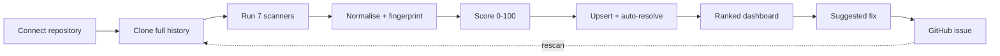
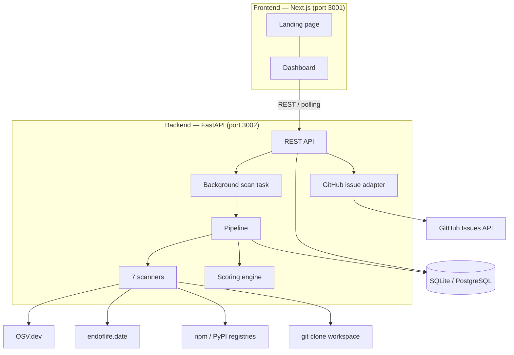

# AEGIS — Every risk, ranked by time left

**AEGIS is a security monitoring platform for code repositories.** It scans a repository for
vulnerable dependencies, leaked secrets, end-of-life runtimes, retiring AI models, risky
licenses and expiring TLS certificates, then ranks *every* finding in one queue by how
severe it is, whether the vulnerable code is actually used, and how much time is left
before it causes an outage or breach. For each risk it shows a concrete fix and can file
it as a GitHub issue in the affected repository.

> The core idea: **treat security as a deadline-management problem.** Every risk gets a
> severity and a "days remaining" value, and the two combine into a single priority score.

---

## Contents

1. [The problem](#1-the-problem)
2. [How it was solved before](#2-how-it-was-solved-before)
3. [The innovation](#3-the-innovation)
4. [How AEGIS works, step by step](#4-how-aegis-works-step-by-step)
5. [The scoring engine](#5-the-scoring-engine)
6. [Architecture](#6-architecture)
7. [Technologies](#7-technologies)
8. [Running the project](#8-running-the-project)
9. [Project structure](#9-project-structure)
10. [API reference](#10-api-reference)
11. [Limitations and roadmap](#11-limitations-and-roadmap)

---

## 1. The problem

Engineering teams face two problems that existing tools treat separately — or not at all.

**Too many findings, no priority.** A typical dependency scanner reports hundreds of
CVEs, all presented with equal urgency. Industry reachability research consistently finds
that most flagged CVEs (commonly cited as 60–80%) sit in code that is never executed.
When a report can't separate the dangerous 20% from the noise, people stop reading it.

**Time-bomb risks nobody tracks.** Many risks are not "vulnerabilities" today but become
an outage or breach on a *known future date*:

- a runtime (Python, Node.js) reaching **end-of-life**, after which new CVEs are never patched;
- an **AI model** being retired by its provider, after which every API call fails;
- a **TLS certificate** expiring and taking the service offline;
- a **copyleft license** in a dependency that legally can't ship in a proprietary product;
- an API key committed months ago and "deleted" — but still sitting in **git history**.

None of these show up in a classic CVE scan, and each has a deadline.

## 2. How it was solved before

| Risk | Typical approach today | Why it falls short |
|---|---|---|
| Vulnerable dependencies | Dependabot, Snyk, `npm audit`, Trivy | Flat lists of CVEs; no signal for whether the package is even used |
| Leaked secrets | Gitleaks / TruffleHog in CI, or nothing | Often run against the latest commit only; results live in a separate tool |
| End-of-life runtimes | Someone remembers, or a spreadsheet | Manual, forgotten until the runtime is already unsupported |
| AI model retirements | Provider deprecation emails | Arrive in someone's inbox; nobody maps them to the code that uses the model |
| Certificate expiry | Separate uptime/cert monitoring | Disconnected from the repository and from the other risks |
| Licenses | Occasional legal review | Rarely continuous; no link to the dependency that introduced it |
| Prioritisation | A human triages each tool's output | Ten tools, ten dashboards, ten different severity scales |

The result is fragmentation: each tool answers one narrow question, nobody gets a single
answer to **"what should we fix this week, and in what order?"**

## 3. The innovation

1. **A unified deadline model.** CVEs, end-of-life dates, AI-model shutdowns, certificate
   expiry and license risks all become rows of the same shape (a normalised `Finding`) with
   an optional due date. One queue, one scale.
2. **Reachability-aware prioritisation.** For every vulnerable package AEGIS checks whether
   first-party code imports it, and whether the imported name is actually used. Unused
   packages are down-ranked (×0.1 or ×0.4) instead of hidden — in the demo repository this
   cuts CVE noise by **38%** while keeping everything visible.
3. **One explainable score.** `severity × urgency × reachability × exposure` collapses every
   kind of risk into a 0–100 priority. Each factor is shown in the UI, and the landing page
   has an interactive playground for the formula.
4. **A closed loop, not a report.** Detection → prioritisation → suggested fix → GitHub
   issue → rescan. Findings are fingerprinted, so a rescan updates them instead
   of duplicating them and **automatically resolves** anything that was fixed.
5. **Risks other scanners don't model:** retiring AI model IDs hard-coded in the source,
   and secrets that exist only in git history.

## 4. How AEGIS works, step by step



**Step 1 — Connect.** The user pastes a public GitHub URL (or clicks *Try demo*). The API
validates it against a strict pattern, stores a `Repository`, creates a `Scan` and queues it
as a background task, so the request returns immediately.
→ [`api/repositories.py`](backend/app/api/repositories.py), [`workspace.py`](backend/app/workspace.py)

**Step 2 — Check out.** The worker clones the repository into an isolated workspace
directory. It is a *full* clone, not a shallow one, because the secret scanner needs every
historical commit.

**Step 3 — Scan.** Seven independent scanners run in order. Each one is isolated: if a data
feed is offline, that scanner's error is recorded and the others still run. After every
step the scan's progress is saved, which drives the live progress bar in the UI.
→ [`pipeline.py`](backend/app/pipeline.py)

| # | Scanner | What it does | Data source |
|---|---|---|---|
| 1 | **Dependencies + reachability** | Parses `package.json` / `package-lock.json` and `requirements.txt`; checks every package in one batch call; merges duplicate advisories (GHSA/PYSEC) and groups them per package; tags each with reachability | [OSV.dev](https://osv.dev) API |
| 2 | **Licenses** | Resolves each dependency's license from its registry and applies a deny-list (AGPL, GPL, SSPL, EUPL; LGPL allowed) | npm registry, PyPI |
| 3 | **Secrets** | Provider-specific regexes (AWS, GitHub, Stripe, OpenAI, Anthropic, Slack, Google, private keys) plus a generic rule gated by Shannon entropy; scans current files **and every line ever added in git history** | local git |
| 4 | **End-of-life runtimes** | Detects versions from `Dockerfile`, `.python-version`, `runtime.txt`, `.nvmrc`, `engines.node`; looks up the support end date | [endoflife.date](https://endoflife.date) API |
| 5 | **AI model retirement** | Greps code and config for model IDs listed in a curated retirement calendar; suggests the replacement | [`model_retirements.json`](backend/app/data/model_retirements.json) |
| 6 | **TLS certificates** | Collects HTTPS hosts referenced in config files, performs a TLS handshake and reads the certificate's expiry | live handshake |
| 7 | **Activity** | Flags repositories with no commits for 180+ days | local git |

**How reachability works** ([`reachability.py`](backend/app/scanners/reachability.py)):
Python files are parsed with the `ast` module; JavaScript/TypeScript imports and `require`
calls are matched with patterns. AEGIS records which local name each import binds, then
checks whether that name is referenced anywhere else in the file:

| Result | Meaning | Score factor |
|---|---|---|
| `reachable` | imported **and** the imported name is used | ×1.0 |
| `imported_not_called` | imported, but the name is never referenced | ×0.4 |
| `declared_only` | in the manifest, never imported anywhere | ×0.1 |

**How secrets are handled safely:** the secret value is **never stored**. AEGIS keeps only a
SHA-256 fingerprint (to deduplicate across rescans) and a redacted preview such as `AKIA••••••••LE`.

**Step 4 — Normalise and fingerprint.** Every scanner emits the same `RawFinding` shape. Each
gets a stable fingerprint (`repository + type + key`), so the same issue keeps its identity
across rescans.

**Step 5 — Score.** The scoring engine computes the priority (see [§5](#5-the-scoring-engine)).

**Step 6 — Persist and auto-resolve.** Findings are upserted by fingerprint. Open findings
that were **not** seen in this scan are marked resolved — unless their scanner errored, so a
network outage never looks like a fix.

**Step 7 — Rank and explain.** The dashboard shows a ranked grid of risk cards, filterable by
risk level and kind. Hovering a card pops up its details; the side panel shows a **suggested
solution** with numbered steps and a ready-to-copy command (for example
`pip install "pyyaml>=5.4"`).
→ [`remediation/messages.py`](backend/app/remediation/messages.py)

**Step 8 — Remediate.** *Create issue* previews the finding exactly as it will appear as a
GitHub issue (title, labels, severity, location, why it matters, recommended fix). With
`GITHUB_TOKEN` configured, AEGIS files the issue in the repository; without it the preview
still works and the UI says what to configure.

**Step 9 — Rescan.** After the fix lands, a rescan no longer sees the finding and closes it
automatically, closing the loop.

## 5. The scoring engine

```
priority = severity_weight × urgency(days_remaining) × reachability_factor × exposure
```

| Factor | Values |
|---|---|
| `severity_weight` | critical 10 · high 7 · medium 4 · low 2 · info 1 |
| `urgency(days)` | overdue → 3.0 · otherwise `1 + 2·e^(−days/30)` (3 days ≈ 2.8, 90 days ≈ 1.1) · no deadline → 1.5 |
| `reachability_factor` | reachable 1.0 · imported, not called 0.4 · declared only 0.1 · not applicable 1.0 |
| `exposure` | public repository 1.25 · private 1.0 |

The raw product is normalised to 0–100 (the maximum is critical × overdue × public).
Examples from the demo repository:

| Finding | Calculation | Score |
|---|---|---|
| Python 3.9 already end-of-life | 7 × 3.0 × 1.0 × 1.0 = 21 | **56** |
| pyyaml 5.3, critical CVE, used | 10 × 1.5 × 1.0 × 1.0 = 15 | **40** |
| minimist 1.2.0, critical CVE, never imported | 10 × 1.5 × 0.1 × 1.0 = 1.5 | **4** |

The same "critical" severity produces 40 or 4 depending on whether the code is used — the
difference between "fix today" and "clean up eventually".
→ [`scoring.py`](backend/app/scoring.py)

## 6. Architecture



**Data model** ([`models.py`](backend/app/models.py)):

| Table | Purpose |
|---|---|
| `Repository` | connected repository: source URL, owner, visibility, last commit / scan |
| `Scan` | one scan run: status, current step, per-scanner report (findings, seconds, error) |
| `Finding` | normalised risk: type, severity, package/versions, reachability, due date, fingerprint, raw details (JSON) |
| `RemediationAction` | issue or alert sent for a finding, with its external URL |

## 7. Technologies

| Layer | Technology | Why |
|---|---|---|
| Backend API | **Python 3.12, FastAPI** | async, typed, auto-generated OpenAPI docs at `/docs` |
| ORM / models | **SQLModel** (SQLAlchemy + Pydantic) | one class is both the DB table and the validated model |
| Database | **SQLite** by default, **PostgreSQL** via `AEGIS_DATABASE_URL` | zero setup for demos; JSON columns for raw scanner output |
| HTTP client | **httpx** | calls OSV.dev, endoflife.date, the registries and GitHub |
| Background work | FastAPI **BackgroundTasks** | scans run off the request thread |
| Code analysis | Python **`ast`**, regex import parsing, **git** CLI | reachability and full-history secret scanning without extra binaries |
| Tests | **pytest** | scoring, reachability and secret-detection unit tests |
| Frontend | **Next.js 15 (App Router), React 19, TypeScript** | typed client mirroring the API schemas |
| Styling | **Tailwind CSS 4** | design tokens as CSS variables |
| Animation | **Framer Motion** for one-off and layout transitions; **CSS keyframes** for loops | looping animations run on the GPU with no per-frame JavaScript |
| Icons / fonts | **lucide-react**, **Space Grotesk** + **JetBrains Mono** | |
| Data feeds | **OSV.dev**, **endoflife.date**, npm & PyPI registries | all free, no API key needed |
| Integration | **GitHub REST API** | files findings as issues |

## 8. Running the project

### Prerequisites

- Python 3.12+, Node.js 20+, and git on your `PATH`
- Internet access (the scanners query OSV.dev, endoflife.date and the package registries)

### 1. Backend — http://localhost:3002

```powershell
cd backend
python -m venv .venv
.\.venv\Scripts\pip install -r requirements.txt
.\.venv\Scripts\python -m uvicorn app.main:app --port 3002
```

Interactive API docs: http://localhost:3002/docs

### 2. Frontend — http://localhost:3001

In a second terminal:

```powershell
cd frontend
npm install
npm run dev -- --port 3001
```

The frontend calls the API at `http://localhost:3002/api` by default. To point it somewhere
else, copy `frontend/.env.example` to `frontend/.env.local` and edit `NEXT_PUBLIC_API_URL`.

For a presentation, use the optimised build — animations start faster than in dev mode:

```powershell
cd frontend
npm run build
npm start -- --port 3001
```

### 3. Try it

1. Open http://localhost:3001 and click **Open Dashboard**.
2. Click **Try demo**. AEGIS builds a deliberately risky sample repository (`demo-shop`) and
   scans it — watch the live progress console.
3. Explore the 18 findings: filter by risk level, hover cards for details, and read the
   suggested fix for each. Click **Create issue** to preview the GitHub issue.

**What's planted in the demo repository** ([`demo_repo.py`](backend/app/demo_repo.py)) — it is
generated with a real two-commit git history:

- vulnerable packages that are **used** (lodash, axios, pyyaml, requests), **imported but unused**
  (jsonwebtoken) and **declared only** (minimist, flask);
- an AWS key in the current code, and OpenAI and Stripe keys that exist **only in git history**
  (committed, then deleted). All keys are fake and assembled at runtime, so this source never
  contains a real secret pattern;
- Python 3.9 (already end-of-life) and Node 22;
- retired AI models `claude-3-opus-20240229` and `gpt-4-32k`;
- a GPL-licensed dependency (PyQt5) and real hosts whose TLS certificates are checked.

### Configuration

| Variable | Default | Purpose |
|---|---|---|
| `GITHUB_TOKEN` | unset | enables creating GitHub issues (needs `issues: write` on the repo) |
| `AEGIS_DATABASE_URL` | `sqlite:///backend/aegis.db` | any SQLAlchemy URL, e.g. PostgreSQL |
| `AEGIS_WORKSPACE_DIR` | `backend/.workspace` | where repositories are cloned |
| `AEGIS_CORS_ORIGIN_REGEX` | any `localhost` port | allowed frontend origins |
| `AEGIS_HTTP_TIMEOUT` | `10` | seconds per external HTTP call |
| `AEGIS_INACTIVE_AFTER_DAYS` | `180` | idle threshold for the activity scanner |

**No API key is required to run AEGIS.** OSV.dev, endoflife.date and the npm/PyPI registries
are free and keyless. `GITHUB_TOKEN` is optional and only enables *creating* issues. The
backend reads it from the process environment (not from a file), so set it in the terminal
before starting the API:

```powershell
$env:GITHUB_TOKEN = "<fine-grained token with Issues: read & write>"
.\.venv\Scripts\python -m uvicorn app.main:app --port 3002
```

### Tests

```powershell
cd backend
.\.venv\Scripts\python -m pytest
```

## 9. Project structure

```
cybersec/
├── backend/
│   ├── app/
│   │   ├── main.py              FastAPI app, CORS, routers
│   │   ├── config.py            settings from environment variables
│   │   ├── database.py          engine and sessions
│   │   ├── models.py            Repository, Scan, Finding, RemediationAction
│   │   ├── schemas.py           API request/response models
│   │   ├── pipeline.py          scan orchestration, progress, upsert, auto-resolve
│   │   ├── scoring.py           the prioritisation engine
│   │   ├── workspace.py         safe cloning into the workspace
│   │   ├── demo_repo.py         generates the demo-shop repository
│   │   ├── api/                 repositories.py, findings.py
│   │   ├── scanners/            base, dependencies, reachability, licenses, secrets,
│   │   │                        eol, ai_models, certificates, activity
│   │   ├── remediation/         messages (fixes, issue text), github_issues
│   │   └── data/                model_retirements.json
│   ├── tests/                   test_scoring.py, test_scanners.py
│   └── requirements.txt
├── frontend/
│   └── src/
│       ├── app/                 page.tsx (landing), dashboard/page.tsx, globals.css
│       ├── components/
│       │   ├── landing/         Hero, VaultScene, HowItWorks, Features, ScoringPlayground, …
│       │   ├── dashboard/       ScanConsole, FindingsBoard, FindingCard, SolutionPanel,
│       │   │                    RemediationDialog, StatCards, ReachabilityFunnel, …
│       │   └── ui/              GlassPanel, Logo, Reveal, AnimatedNumber
│       └── lib/                 api.ts, types.ts, format.ts, scoring.ts, markdown.tsx
└── AEGIS-Design-and-Implementation-Plan.html
```

## 10. API reference

All routes are under `/api`. Full interactive docs at `/docs`.

| Method | Route | Description |
|---|---|---|
| `GET` | `/repositories` | connected repositories with their latest scan |
| `POST` | `/repositories` | connect `{ "source": "<github url>" \| "demo" }` and queue a scan |
| `POST` | `/repositories/{id}/scans` | rescan |
| `GET` | `/repositories/scans/{scan_id}` | scan status and live progress |
| `DELETE` | `/repositories/{id}` | disconnect and delete its findings |
| `GET` | `/findings` | open findings ranked by priority (`?repo_id=`, `?type=`) |
| `GET` | `/stats` | totals, severity/type breakdown, reachability noise reduction |
| `POST` | `/findings/{id}/resolve` | mark resolved |
| `GET` | `/findings/{id}/remediation` | preview of the GitHub issue |
| `POST` | `/findings/{id}/remediation` | create the GitHub issue (needs `GITHUB_TOKEN`) |
| `GET` | `/integrations` | whether GitHub issue creation is configured |
| `POST` | `/deadlines` | add a custom deadline (scored like any other finding) |
| `GET` | `/health` | health check |

## 11. Limitations and roadmap

Honest scope of this version, mapped to the phases in the design plan:

| Area | Now | Next |
|---|---|---|
| Job queue | FastAPI BackgroundTasks in the API process | Celery + Redis workers, scheduled rescans with Celery Beat |
| Database | SQLite by default | PostgreSQL (already supported via `AEGIS_DATABASE_URL`) |
| Reachability | Tier 1: import + name-usage analysis (Python, JS/TS) | Tier 2: function-level call graphs (e.g. OSV-Scanner call analysis) |
| Ecosystems | npm, PyPI | Go, Maven, Cargo lockfiles |
| Secrets | pattern + entropy detection, full history | live verification of whether a key still works (TruffleHog-style) |
| AI models / APIs | curated retirement calendar (verify dates against provider pages) | scheduled ingestion of provider deprecation feeds; API sunset calendar |
| Remediation | GitHub issues, suggested fix commands | automated fix pull requests; chat alerts |
| Advanced | — | SAST (Semgrep), DAST (OWASP ZAP in a sandbox), WAF rules for the platform |
| Access | public repositories via HTTPS | GitHub App authentication for private repos and webhooks |

Reachability is a **prioritisation signal, not a reason to ignore** a finding: dynamic imports
and reflection can hide real usage, so down-ranked findings always stay visible.

**Ethics:** AEGIS only scans repositories you own or are authorised to assess. It performs
read-only analysis of source code; it never attacks third-party systems.
